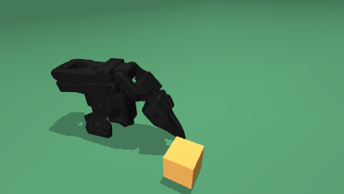

# SO-101 Vision RL

Vision-based PPO for picking and lifting a 5 cm cube with an SO-101 arm.
Physics and batch rendering run on the GPU through MuJoCo-MJX/Warp;
the policy uses JAX, Flax and Optax. Placement is a later task.

## Project structure

```text
vision_rl/
  envs/          task, joint control, grasp geometry and vector environments
    assets/      current scene XML, robot meshes and mesh license
  models/        image encoder and actor-critic network
  ppo/           PPO updates and advantage calculation
  rendering/     GPU camera and low-poly visual meshes
  rewards/       pick reward and reward-hacking audit
  camera.py      shared camera settings and image resizing
  train.py       training loop, logging and checkpoints
scripts/         commands listed below
tests/           scene, camera, reward, control and evaluation checks
images/          freshly rendered views of the current scene only
runs/            saved configurations, checkpoints, metrics and evaluations
```

`runs/` is local and Git-ignored. Keep existing runs to resume training or
compare evaluations. `.claude/` and `CLAUDE.md` contain assistant configuration;
Python caches and `*.egg-info/` are generated files, not project source.

## Install

```bash
conda activate vision_rl
pip install "jax[cuda12]"
pip install -e ".[dev,tools]"
```

Dependencies live in `pyproject.toml`; `requirements.txt` installs the same
extras. The scene setup GUI also needs Tk support in the Python environment.

## Commands

Run these from the project root.

| Task | Command |
| --- | --- |
| Inspect the scene in a GUI | `python scripts/view.py` |
| Align the real camera and edit the scene | `python scripts/setup.py` |
| Train pick-and-place from a pick checkpoint | `python scripts/pick_place.py --source runs/first_lift40_live --run runs/pick_place_new` |
| Train headlessly | `python scripts/pick.py --run runs/pick_clean --image-dr` |
| Train with a live viewer | `python scripts/pick.py --run runs/pick_clean --image-dr --live` |
| Resume a saved run | `python scripts/pick.py --resume runs/pick_clean` |
| Watch a saved policy | `python scripts/watch.py --run runs/pick_clean` |
| Evaluate camera use and sustained lifts | `python scripts/evaluate.py --run runs/pick_clean --episodes 100` |
| Check scripted grasp feasibility | `python scripts/check_pick.py --physics-only` |
| Audit reward incentives | `python scripts/check_reward.py --only ours` |
| Run tests on the CPU | `JAX_PLATFORMS=cpu MUJOCO_GL=egl python -m pytest -q tests` |
| Read training charts | `tensorboard --logdir runs` |

Use a new run name for each fresh training run. The headless and live training
commands above are alternatives. All scripts support `--help`.

## Current environment

- Table surface: z = 0.40 m; cube centre starts at (0.239, -0.175, 0.425) m.
- The box geometry is disabled for unobstructed pick training. Its empty body
  remains as a reference for scene setup tools.
- Main camera: `realsense_d455_rgb`, 424×240 RGB. Training uses the square image
  size and frame stack recorded in each run's `config.json` (defaults: 128, 3).
- `setup_env.py` saves scene edits and writes `.xml.bak` backups, ignored by Git.
- Reward and loss describe learning signals. Assess robot performance using
  recorded evaluations, sustained lift duration and grasp checks.

Refresh the two scene previews without opening a window:

```bash
MUJOCO_GL=egl python scripts/view.py --save images/current_env.png
```

This saves `current_env.png` at 424×240 and `current_env_224.png` at 224×224.
These previews show the XML home pose; training resets may open the jaw and
randomize the starting state.


